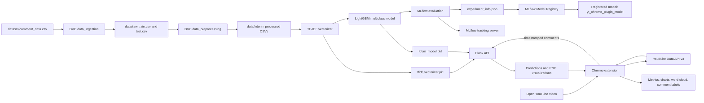

# YouTube Comment Sentiment Analysis: End-to-End MLOps System

## Title Page

**Project title:** YouTube Comment Sentiment Analysis: An End-to-End MLOps Pipeline  
**Project type:** Machine learning system and interactive Chrome extension  
**Author:** [TO BE FILLED]  
**Institution/Organization:** [TO BE FILLED]  
**Supervisor/Reviewer:** [TO BE FILLED]  
**Date:** [TO BE FILLED]  
**Report format:** Markdown  
**Target length:** Approximately 2,500–3,500 words

## Abstract

This project presents an end-to-end YouTube comment sentiment analysis system that connects a reproducible offline machine learning workflow with an interactive online application. The offline workflow ingests a labeled comment dataset, removes invalid records, normalizes text, extracts TF-IDF features, trains a multiclass LightGBM classifier, evaluates the model with MLflow, and registers the resulting model in the MLflow Model Registry. DVC defines the stage dependencies and stores the pipeline state so that data preparation, model training, and evaluation can be reproduced. The repository’s primary dataset contains 37,249 labeled comments across three classes: positive (`1`), neutral (`0`), and negative (`-1`). The implemented split contains 29,434 training rows and 7,359 test rows.

The online component consists of a Manifest V3 Chrome extension and a Flask API. The extension identifies the open YouTube video, retrieves up to 500 comments through YouTube Data API v3, and sends timestamped comments to the API. The API applies the same normalization and TF-IDF transformation used during training and predicts sentiment with the serialized LightGBM model. It also generates a sentiment-distribution chart, a monthly sentiment trend graph, and a word cloud. The extension displays summary measures and the first 25 predicted comments. The repository confirms the architecture, parameters, interfaces, and dataset counts; however, a complete final classification report, confusion-matrix values, production hosting configuration, and several dataset metadata fields are not included. Those items are explicitly marked `[TO BE FILLED]` rather than inferred.

## 1. Introduction

### 1.1 Problem statement

YouTube videos can attract large volumes of viewer comments that express approval, disagreement, questions, criticism, or mixed reactions. Manually reviewing these comments is slow and difficult to scale. A sentiment analysis system can provide a compact view of audience response by assigning each comment to a positive, neutral, or negative category and summarizing the resulting distribution.

The engineering challenge is broader than training a classifier. A useful system must preserve consistency between training and inference, make experiments auditable, reproduce model artifacts, expose a reliable inference interface, and present results in a form that a non-specialist user can interpret. This project addresses those requirements through an MLOps-oriented offline pipeline and a browser-based application.

### 1.2 Motivation

The project is motivated by the need to convert unstructured viewer feedback into timely indicators of audience sentiment. The Chrome extension reduces the friction of analysis: a user opens a YouTube video, launches the extension, and receives predictions and visual summaries without manually exporting comments. The DVC and MLflow components address the corresponding reproducibility and lifecycle requirements for the model.

### 1.3 Objectives

The system objectives are to:

1. Build a repeatable ingestion, preprocessing, training, evaluation, and registration workflow.
2. Train a three-class sentiment classifier using TF-IDF features and LightGBM.
3. Track parameters, metrics, artifacts, and model metadata with MLflow.
4. Version pipeline dependencies and outputs with DVC.
5. Serve predictions and visualizations through a Flask API.
6. Integrate the API with a Manifest V3 Chrome extension.
7. Present sentiment distributions, temporal trends, word frequencies, and comment-level labels.

## 2. Literature and Technical Background

Sentiment analysis is a natural-language processing task in which text is classified according to an opinion polarity or affective category. Classical supervised approaches commonly combine text normalization, sparse lexical features, and a discriminative classifier. They remain useful when compute, latency, or operational simplicity is important.

TF-IDF represents a document using weighted term features. A term receives a larger weight when it is frequent in a document but relatively uncommon across the corpus. Extending the representation from unigrams to n-grams allows the model to capture short phrases such as “not useful” or “very well explained.” The representation is sparse and can be efficient for moderate-sized datasets.

Gradient-boosting methods construct an ensemble of decision trees sequentially, with later trees emphasizing errors made by earlier trees. LightGBM is a gradient-boosting implementation designed for speed and memory efficiency. In this project it is configured for multiclass classification and receives the TF-IDF feature matrix as input.

MLflow provides experiment tracking, artifact storage, model logging, and model registration. DVC provides a declarative pipeline and content-addressed tracking for data and generated outputs. Together, these tools separate model experimentation from application delivery while making the path from raw data to deployable artifacts explicit.

## 3. System Architecture

The system has two connected planes:

* **Offline ML plane:** `dataset/comment_data.csv` → ingestion and split → preprocessing → TF-IDF and LightGBM training → MLflow evaluation → model registration.
* **Online application plane:** YouTube page → Chrome extension → YouTube Data API v3 → Flask prediction API → local TF-IDF and LightGBM artifacts → extension visualizations.

The offline plane produces `tfidf_vectorizer.pkl` and `lgbm_model.pkl`. The current online implementation loads those local files at Flask startup. Although the model is registered as `yt_chrome_plugin_model` in MLflow and transitioned to the Staging stage, the online API does not currently load the model directly from the registry.

### Suggested Mermaid architecture diagram



## 4. Dataset Description and Exploratory Analysis

The primary dataset is [`dataset/comment_data.csv`](dataset/comment_data.csv). The repository identifies two columns:

| Column | Role |
|---|---|
| `clean_comment` | Comment text used as the model input |
| `category` | Sentiment label: `1` positive, `0` neutral, `-1` negative |

The source name, collection date, annotation procedure, and original dataset citation are not documented in the repository and should be added as `[TO BE FILLED]`.

### 4.1 Dataset size and class distribution

The checked-in primary dataset contains 37,249 rows. The current raw train/test artifacts contain 29,434 and 7,359 rows respectively, corresponding to the configured 80/20 split.

| Dataset | Total | Negative (`-1`) | Neutral (`0`) | Positive (`1`) |
|---|---:|---:|---:|---:|
| Full `comment_data.csv` | 37,249 | 8,277 (22.22%) | 13,142 (35.28%) | 15,830 (42.50%) |
| Training split | 29,434 | 6,579 (22.35%) | 10,185 (34.60%) | 12,670 (43.05%) |
| Test split | 7,359 | 1,671 (22.71%) | 2,587 (35.15%) | 3,101 (42.14%) |

The data is moderately imbalanced, with positive comments as the largest class and negative comments as the smallest. The implementation uses `class_weight="balanced"` and `is_unbalance=True` in LightGBM, although the effect of those settings should be verified with per-class test metrics.

### 4.2 Exploratory analysis

The repository includes a preprocessing and EDA notebook, but the report does not infer plots or statistical findings that are not persisted as documented results. The following items should be completed from the notebook or a fresh analysis:

* comment-length distribution: [TO BE FILLED]
* most frequent terms and n-grams: [TO BE FILLED]
* duplicate and missing-row counts before cleaning: [TO BE FILLED]
* label distribution visualization: [TO BE FILLED]
* language composition: [TO BE FILLED]

The presence of multilingual or code-switched text is a relevant limitation because the implemented normalizer retains only ASCII letters, digits, whitespace, and selected punctuation.

## 5. Methodology

### 5.1 Data ingestion and splitting

`data_ingestion.py` downloads the configured raw GitHub CSV, removes missing records, removes duplicate rows, removes rows whose `clean_comment` is empty after trimming, and performs `train_test_split` with `test_size=0.20` and `random_state=42`. The outputs are:

* `data/raw/train.csv`
* `data/raw/test.csv`

The fixed random seed supports repeatable partitioning when the source data is unchanged. The split is not explicitly stratified in the implementation; the resulting class proportions are nevertheless similar between the training and test files.

### 5.2 Text preprocessing

The same general normalization logic is implemented in the offline preprocessing module and the Flask API:

1. Convert text to lowercase.
2. Trim leading and trailing whitespace.
3. Replace newline characters with spaces.
4. Remove characters outside ASCII letters, digits, whitespace, and `!?.,`.
5. Remove English stopwords while retaining `not`, `but`, `however`, `no`, and `yet`.
6. Lemmatize tokens with `WordNetLemmatizer`.

The processed files are written to `data/interim/train_processed.csv` and `data/interim/test_processed.csv`. Keeping the inference preprocessing aligned with training is essential because any mismatch changes the TF-IDF vocabulary and feature values.

### 5.3 Feature engineering: TF-IDF

The model-building stage fits `sklearn.feature_extraction.text.TfidfVectorizer` only on the processed training comments. The vectorizer is configured as follows:

| Parameter | Value |
|---|---:|
| `max_features` | 1,000 |
| `ngram_range` | `(1, 3)` |
| Fit data | Processed training comments |
| Output artifact | `tfidf_vectorizer.pkl` |

The saved vectorizer must remain paired with the saved LightGBM model because it defines the vocabulary and feature ordering consumed by the classifier.

### 5.4 Model training: LightGBM

The classifier is `lightgbm.LGBMClassifier` configured for three-class multiclass prediction:

| Hyperparameter | Value |
|---|---:|
| `objective` | `multiclass` |
| `num_class` | 3 |
| `metric` | `multi_logloss` |
| `is_unbalance` | `True` |
| `class_weight` | `balanced` |
| `reg_alpha` | 0.1 |
| `reg_lambda` | 0.1 |
| `learning_rate` | 0.09 |
| `max_depth` | 20 |
| `n_estimators` | 367 |

The trained model is serialized as `lgbm_model.pkl`. The repository does not document a systematic hyperparameter search space or cross-validation protocol; those details are `[TO BE FILLED]`.

### 5.5 Experiment tracking and evaluation: MLflow

The evaluation stage sets the following MLflow configuration:

| Item | Value |
|---|---|
| Tracking URI | `http://ec2-100-28-125-79.compute-1.amazonaws.com:5000/` |
| Experiment | `dvc-pipeline-runs` |
| Logged parameters | Values loaded from `params.yaml` |
| Logged artifacts | LightGBM model, TF-IDF vectorizer, confusion matrix |
| Evaluation | `classification_report` and `confusion_matrix` on the test set |
| Run ID in repository | `a2ec12142d504ce5bb98fd75237cb680` |

The final accuracy and per-class metrics are not stored in a readable repository artifact. They must be entered from the MLflow run:

| Metric | Negative (`-1`) | Neutral (`0`) | Positive (`1`) | Overall |
|---|---:|---:|---:|---:|
| Precision | [TO BE FILLED] | [TO BE FILLED] | [TO BE FILLED] | [TO BE FILLED] |
| Recall | [TO BE FILLED] | [TO BE FILLED] | [TO BE FILLED] | [TO BE FILLED] |
| F1-score | [TO BE FILLED] | [TO BE FILLED] | [TO BE FILLED] | [TO BE FILLED] |
| Support | 1,671 | 2,587 | 3,101 | 7,359 |

The overall accuracy is `[TO BE FILLED]`; macro and weighted averages are also `[TO BE FILLED]`.

### 5.6 Model registry and versioning

`register_model.py` constructs a `runs:/` URI from `experiment_info.json`, registers the model under `yt_chrome_plugin_model`, and transitions the created version to the MLflow `Staging` stage. The exact registered version number is `[TO BE FILLED]`. The vectorizer is tracked as an artifact but is not independently registered as a model.

### 5.7 Pipeline reproducibility with DVC

`dvc.yaml` defines five stages: `data_ingestion`, `data_preprocessing`, `model_building`, `model_evaluation`, and `model_registration`. `dvc.lock` records dependency, parameter, and output hashes for a concrete pipeline state. A complete reproduction can be initiated with:

```bash
dvc repro
```

The ingestion stage requires network access because it reads the configured raw GitHub URL. Reproducibility should be interpreted as reproducibility of the declared source revision and parameters; changes to a remote dataset without a corresponding versioned reference can change results.

## 6. Application Implementation

### 6.1 Flask API

The Flask application runs on `0.0.0.0:5000` in the repository’s development entry point and enables CORS. It loads the local pickle model and vectorizer at startup. The production hosting method, process manager, container platform, TLS configuration, and authentication policy are `[TO BE FILLED]`.

| Endpoint | Method | Request | Response |
|---|---|---|---|
| `/` | GET | None | Plain-text welcome message |
| `/predict` | POST | `{"comments": ["..."]}` | JSON list of `{comment, sentiment}` |
| `/predict_with_timestamps` | POST | `{"comments": [{"text": "...", "timestamp": "...", "authorId": "..."}]}` | JSON list preserving comment, sentiment, and timestamp |
| `/generate_chart` | POST | `{"sentiment_counts": {"1": 20, "0": 10, "-1": 5}}` | PNG pie chart |
| `/generate_wordcloud` | POST | `{"comments": ["..."]}` | PNG word cloud |
| `/generate_trend_graph` | POST | `{"sentiment_data": [{"timestamp": "...", "sentiment": 1}]}` | PNG monthly percentage trend graph |

Invalid or missing inputs return JSON errors with HTTP 400. Prediction and visualization exceptions return HTTP 500 with an error description. The API currently converts sparse TF-IDF matrices to dense arrays before prediction; memory and batch-size behavior under production load should be measured.

### 6.2 Chrome extension

The extension uses Manifest V3. When the popup opens, it checks the active tab for a YouTube watch URL and extracts the 11-character video ID. It calls the YouTube Data API `commentThreads` endpoint with up to 100 comments per page, follows pagination, and stops at 500 comments or when no next page exists. Each item retains text, publication timestamp, and author channel ID.

The extension sends timestamped comments to `/predict_with_timestamps`, counts predictions by class, computes total comments, unique commenters, average comment length, and a normalized sentiment score on a 0–10 display scale. It then requests the pie chart, monthly trend graph, and word cloud. The popup lists the first 25 comments with their predicted labels.

The extension currently contains an API key in `popup.js`. This is a security and operational concern: the key should be rotated if it has been exposed, restricted in Google Cloud, and managed according to the deployment environment rather than treated as a secret in client-side code.

## 7. Results and Discussion

### 7.1 Quantitative results

The test set contains 7,359 rows. The repository provides the evaluation procedure and a confusion-matrix image, but not machine-readable final matrix values or a complete final metric table. Therefore, no performance claim is made here:

| Result | Value |
|---|---:|
| Test accuracy | [TO BE FILLED] |
| Macro precision | [TO BE FILLED] |
| Macro recall | [TO BE FILLED] |
| Macro F1 | [TO BE FILLED] |
| Weighted precision | [TO BE FILLED] |
| Weighted recall | [TO BE FILLED] |
| Weighted F1 | [TO BE FILLED] |

### 7.2 Confusion-matrix analysis

The confusion matrix should be read with rows representing actual labels and columns representing predicted labels. The completed analysis should identify:

* the class with the highest recall: [TO BE FILLED]
* the class with the lowest recall: [TO BE FILLED]
* the most frequent confusion pair: [TO BE FILLED]
* whether neutral comments are confused with both polarity classes: [TO BE FILLED]

### 7.3 Strengths and weaknesses

Strengths include a clearly staged pipeline, fixed split seed, paired model/vectorizer artifacts, explicit experiment logging, DVC reproducibility, and a user-facing integration that exposes both aggregate and comment-level results. The main weaknesses are the absence of documented final metrics, dependence on local pickle files for live inference, development-oriented API hosting, client-side API-key exposure, ASCII-oriented preprocessing, and the lack of documented monitoring or drift detection.

## 8. Challenges and Limitations

1. **Class imbalance:** Positive comments are 42.50% of the source data while negative comments are 22.22%. Balanced weighting is enabled, but class-wise validation remains necessary.
2. **Sarcasm and context:** Lexical TF-IDF features may interpret sarcastic or context-dependent comments incorrectly.
3. **Multilingual comments:** Non-ASCII characters are removed by the current normalizer, which can discard meaning in multilingual or code-switched comments.
4. **API quota:** YouTube Data API quotas can constrain comment retrieval and require key restrictions and quota monitoring.
5. **500-comment cap:** The extension analyzes at most 500 comments, so results are a sample rather than a complete video-level population.
6. **Latency:** Comment retrieval, preprocessing, dense conversion, inference, and three image-generation requests occur sequentially from the browser.
7. **Operational resilience:** Production hosting, authentication, rate limiting, health checks, structured logging, and autoscaling are `[TO BE FILLED]`.
8. **Data and label provenance:** Source citation, annotation guidance, and inter-annotator agreement are `[TO BE FILLED]`.

## 9. Future Work

Recommended next steps are:

* evaluate transformer models such as BERT or a compact DistilBERT alternative;
* add multilingual or language-aware models and preserve Unicode during preprocessing;
* load the production model from MLflow Registry with explicit version or alias promotion;
* containerize the Flask service and deploy it to a documented cloud platform;
* add CI/CD for tests, DVC pipeline validation, model checks, and controlled deployment;
* add request batching, asynchronous chart generation, caching, and latency measurements;
* implement monitoring for API errors, class distribution, confidence, data drift, and model drift;
* add authentication, rate limiting, secret management, and YouTube API key restrictions;
* add stratified validation, calibration, threshold analysis, and error review for sarcasm and multilingual text;
* document the dataset source, labeling process, license, and governance controls.

## 10. Conclusion

The project demonstrates a complete path from labeled comment data to an interactive sentiment-analysis experience. Its offline workflow separates ingestion, preprocessing, feature engineering, training, evaluation, and registration, while DVC and MLflow provide complementary reproducibility and experiment-management capabilities. Its online workflow connects YouTube comment retrieval, Flask inference, and browser visualizations in a straightforward user journey.

The system’s verified data scale is 37,249 labeled comments, split into 29,434 training rows and 7,359 test rows. The implementation uses English-oriented normalization, TF-IDF unigrams through trigrams with at most 1,000 features, and a three-class LightGBM classifier with the parameters documented in this report. The architecture is a sound baseline for operational sentiment analysis. Before production claims are made, the missing final metrics, confusion-matrix interpretation, deployment details, data provenance, and security controls should be completed and validated.

## 11. References

1. scikit-learn, “TfidfVectorizer documentation.” URL: [TO BE FILLED]
2. LightGBM documentation, “LGBMClassifier.” URL: [TO BE FILLED]
3. MLflow documentation, “Tracking and Model Registry.” URL: [TO BE FILLED]
4. DVC documentation, “Pipelines and Reproducibility.” URL: [TO BE FILLED]
5. Flask documentation. URL: [TO BE FILLED]
6. Google Developers, “YouTube Data API v3.” URL: [TO BE FILLED]
7. NLTK documentation, “WordNetLemmatizer and stopwords.” URL: [TO BE FILLED]
8. Project source repository: `Gireesh-Kumar-Gowd/YouTube-Viewer-Sentiment-Analysis-End-to-End-MLOps-Pipeline`.

## 12. Appendix

### A. Project folder structure

```text
.
├── dataset/comment_data.csv
├── data/raw/{train.csv,test.csv}
├── data/interim/{train_processed.csv,test_processed.csv}
├── src/youtubeViewerSentimentAnalysis/
│   ├── data/{data_ingestion.py,data_preprocessing.py}
│   └── model/{model_building.py,model_evaluation.py,register_model.py}
├── flask_app/main.py
├── yt-chrome-plugin-frontend/{manifest.json,popup.html,popup.js}
├── dvc.yaml
├── dvc.lock
├── params.yaml
├── lgbm_model.pkl
├── tfidf_vectorizer.pkl
└── experiment_info.json
```

### B. Sample API request and response

```json
POST /predict_with_timestamps
{
  "comments": [
    {
      "text": "This video is excellent",
      "timestamp": "2026-09-22T12:00:00Z",
      "authorId": "channel-id"
    }
  ]
}
```

```json
[
  {
    "comment": "This video is excellent",
    "sentiment": "1",
    "timestamp": "2026-09-22T12:00:00Z"
  }
]
```

### C. Key commands

```bash
# Reproduce the DVC pipeline
dvc repro

# Start the Flask API from the repository root
python flask_app/main.py

# Start the MLflow user interface
mlflow ui
```

### D. Items requiring completion before final submission

* Author, institution, supervisor, and date: [TO BE FILLED]
* Dataset citation, source provenance, annotation method, and license: [TO BE FILLED]
* Final MLflow accuracy and per-class precision, recall, and F1: [TO BE FILLED]
* Final confusion-matrix counts and interpretation: [TO BE FILLED]
* Registered model version and promotion history: [TO BE FILLED]
* Flask hosting, deployment topology, and production URL: [TO BE FILLED]
* API latency, throughput, and monitoring results: [TO BE FILLED]
